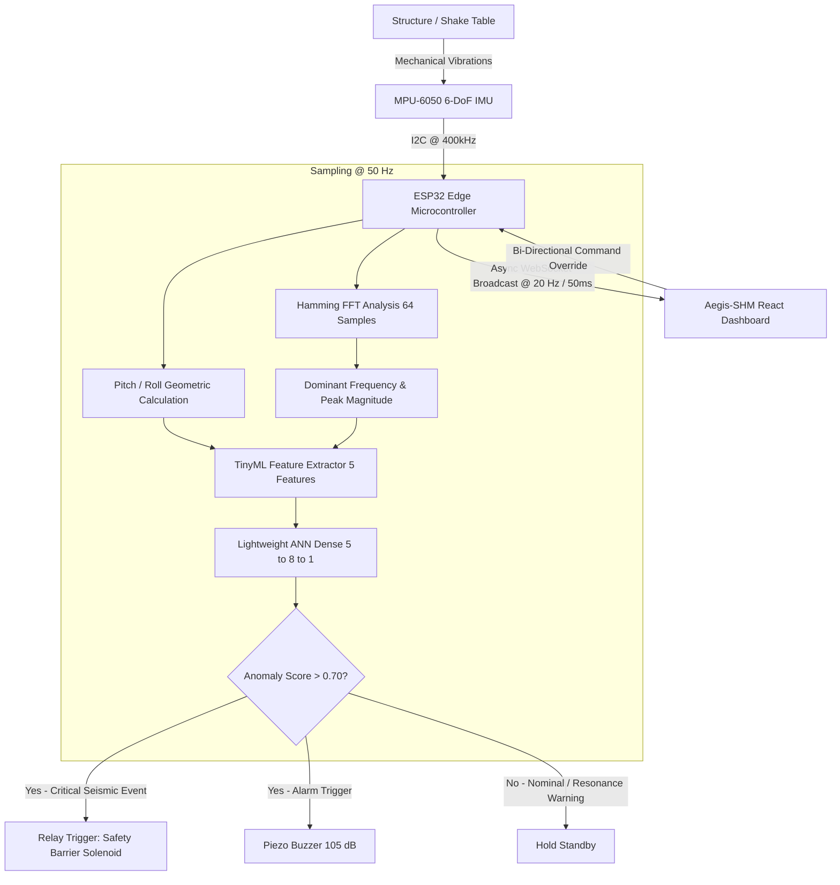

# Aegis-SHM // Edge Structural Health & Seismic Hazard Monitor

[](https://www.espressif.com/)
[](https://github.com/AdityaBanavali/StrStat)
[](https://react.dev/)
[](https://tailwindcss.com/)
[](LICENSE)

An industrial-grade, dark-mode cyber-physical telemetry dashboard and edge computing system designed for real-time Structural Health Monitoring (SHM), mechanical resonance detection, and automated seismic hazard mitigation.

Powered by an **ESP32** running an on-device **TinyML Multi-Layer Perceptron (ANN)** and **Fast Fourier Transform (FFT)** connected to an **MPU-6050** 6-DoF sensor, streaming live packets to a high-density mission-control React console.

---

## System Architecture



---

## Key Capabilities

- **Zero-Fake-Data Enforcement:** When edge hardware is disconnected, all charts flatline and numerical readouts render strict `null`/`--` states. No fake oscillating sine waves are displayed unless the operator explicitly activates the manual `MOCK DEV FEED`.
- **Edge TinyML Inference:** Sub-millisecond ANN classification on the microcontroller predicting structural collapse or seismic excursions before catastrophic failure occurs.
- **On-Chip Harmonic FFT Engine:** Real-time extraction of dominant excitation frequency ($f_{exc}$) to detect structural natural frequency convergence ($f_n \approx 3.20\text{ Hz}$).
- **High-Performance Canvas Waveform Stream:** Rolling 100-sample live tri-axial accelerometer visualizer calibrated in $g$ with zero layout shift or garbage-collection overhead.
- **Fail-Safe Physical Actuation:** Automated relay trip driving an emergency barrier solenoid with real-time manual software overrides over WebSocket.

---

## Hardware Specification & Wiring Pinout

| Peripheral | ESP32 Pin | Function | Notes |
| :--- | :--- | :--- | :--- |
| **MPU-6050 SDA** | `GPIO 21` | I2C Data | FastMode 400 kHz with pull-ups |
| **MPU-6050 SCL** | `GPIO 22` | I2C Clock | FastMode 400 kHz with pull-ups |
| **Relay Solenoid** | `GPIO 23` | Safety Barrier Driver | Active HIGH trigger |
| **Piezo Buzzer** | `GPIO 19` | Audible Siren Alarm | Active HIGH trigger (105 dB) |
| **Status LED** | `GPIO 2` | Heartbeat & System Health | Blinks on boot, solid when active |

---

## Edge TinyML Model Specification

The ESP32 runs a custom forward-propagation inference neural network directly in C++ without heavy framework dependencies:

```
Input Vector [5] ──► Dense [8, ReLU] ──► Dense [1, Sigmoid] ──► Anomaly Score (0.00 - 1.00)
```

### Input Feature Tensor
1. `x[0]`: Dynamic Normalized Acceleration Magnitude ($g$)
2. `x[1]`: Absolute Angular Pitch Deflection ($\text{deg} / 45^\circ$)
3. `x[2]`: Absolute Angular Roll Deflection ($\text{deg} / 45^\circ$)
4. `x[3]`: FFT Dominant Frequency Ratio ($f_{exc} / 25\text{ Hz}$)
5. `x[4]`: Peak Spectral Amplitude Magnitude

### Operational State Brackets

| Anomaly Score | System State | Hardware Response |
| :--- | :--- | :--- |
| **$\le 0.40$** | `NOMINAL` | Solenoid retracted, buzzer silent, green status pill |
| **$0.40 - 0.70$** | `RESONANCE_WARNING` | Elevated harmonic excitation alert, amber banner |
| **$> 0.70$** | `SEISMIC_EVENT` | **Instant barrier trip (GPIO 23)**, acoustic siren (GPIO 19) |

---

## WebSocket Telemetry Protocol

Live JSON payload broadcast by the ESP32 over `ws://<ESP32_IP>/ws` every 50 ms:

```json
{
  "connected": true,
  "timestamp": 1728749280123,
  "imu": {
    "accel": { "x": 0.021, "y": -0.014, "z": 0.982 },
    "tilt": { "pitch": 1.20, "roll": -0.40 }
  },
  "fft": {
    "dominant_freq_hz": 4.20,
    "peak_magnitude": 0.180
  },
  "inference": {
    "anomaly_score": 0.120,
    "probability": 0.120,
    "state": "NOMINAL",
    "inference_latency_ms": 14
  },
  "actuator": {
    "safety_barrier_deployed": false,
    "buzzer_state": false
  }
}
```

### Manual Command Payload (Dashboard ➔ ESP32)
```json
{
  "toggle_actuator": true
}
```

---

## Quickstart Guide

### 1. ESP32 Firmware Setup

1. Open [`esp32/esp32.ino`](esp32/esp32.ino) in Arduino IDE or PlatformIO.
2. Install required Arduino libraries:
   - `Adafruit MPU6050`
   - `Adafruit Unified Sensor`
   - `ArduinoJson` (v6+)
   - `arduinoFFT` (v2+)
   - `ESPAsyncWebServer`
   - `AsyncTCP`
3. Update Wi-Fi credentials:
   ```cpp
   const char *WIFI_SSID = "YOUR_WIFI_SSID";
   const char *WIFI_PASSWORD = "YOUR_WIFI_PASSWORD";
   ```
4. Flash to your ESP32 board and open Serial Monitor at `115200 baud` to note the assigned IP address.

### 2. Frontend Dashboard Setup

```bash
# Clone the repository
git clone https://github.com/AdityaBanavali/StrStat.git
cd StrStat

# Run one-shot setup script (installs dependencies and starts dev server)
./dev.sh
```

Alternatively via npm:

```bash
npm install
npm run dev
```

Visit `http://localhost:5173/` in your browser. Enter your ESP32 IP in the **NODE IP** input field to begin streaming live telemetry.

---

## Project Structure

```
.
├── dev.sh                     # Automated environment launch script
├── index.html                 # HTML5 entry point
├── package.json               # NPM package configuration
├── tsconfig.json              # TypeScript compilation rules
├── tailwind.config.js         # Technical palette configuration
├── esp32/
│   └── esp32.ino              # High-frequency sampling & TinyML firmware
└── src/
    ├── main.tsx               # React DOM bootstrapping
    ├── index.css              # Technical typography & styling tokens
    ├── types.ts               # Complete telemetry TypeScript interfaces
    ├── App.tsx                # Master mission-control dashboard layout
    ├── hooks/
    │   └── useEspTelemetry.ts # Dedicated edge connection & state hook
    └── components/
        ├── ConnectionBar.tsx  # Network health, latency, & IP controls
        ├── TelemetryGraph.tsx # Rolling Canvas tri-axial accelerometer scope
        ├── FrequencySpectrum.tsx # FFT resonance distribution visualizer
        ├── TiltVisualizer.tsx # Crosshair digital bubble reticle
        ├── InferenceCard.tsx  # TinyML anomaly gauge & state indicators
        ├── ActuatorStatus.tsx # Hardware solenoid trip & siren overrides
        └── EventLog.tsx       # Monospaced incident audit feed
```

---

## License

Distributed under the **MIT License**. See [`LICENSE`](LICENSE) for complete terms.
